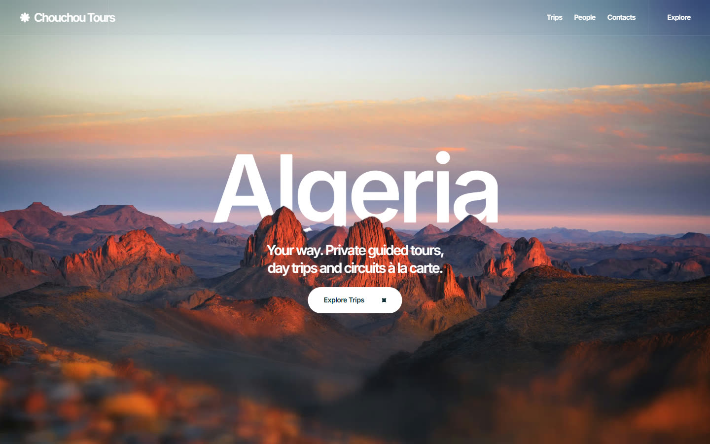
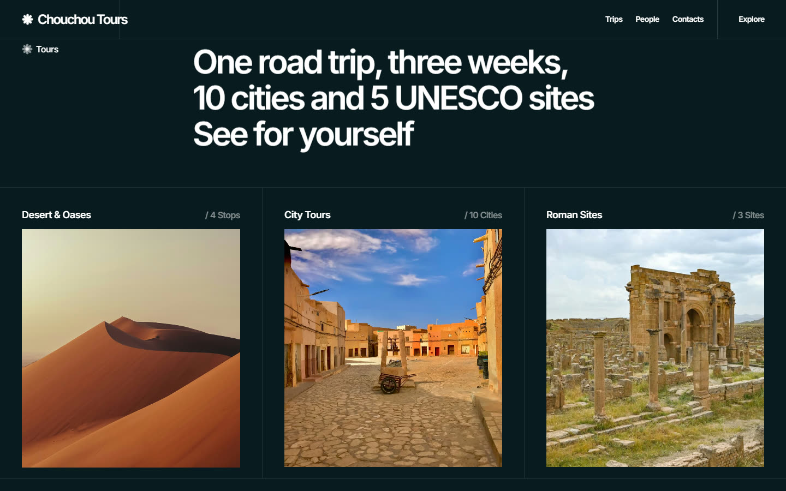
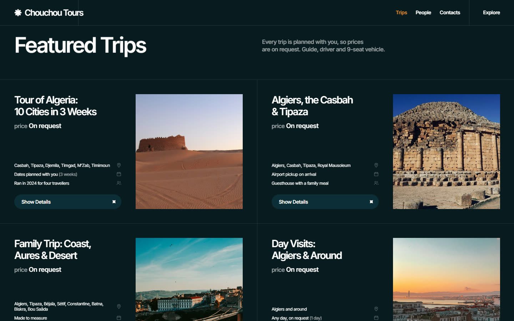
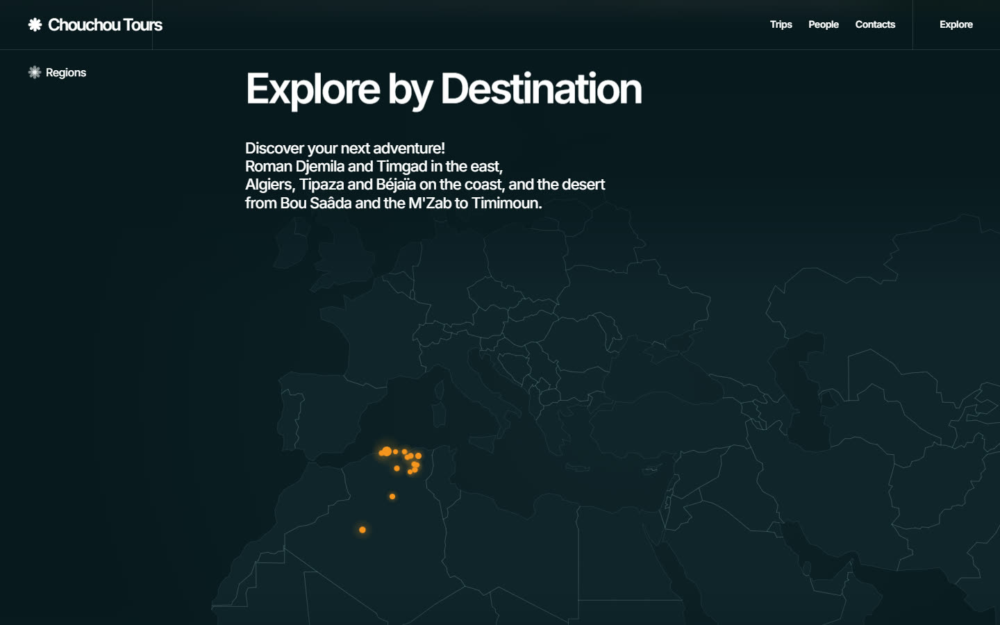
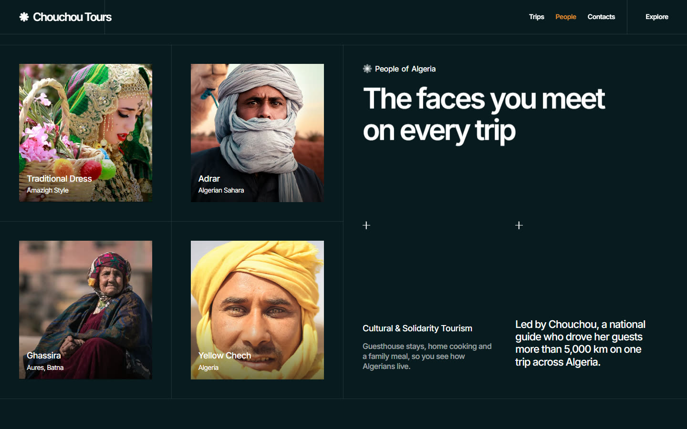
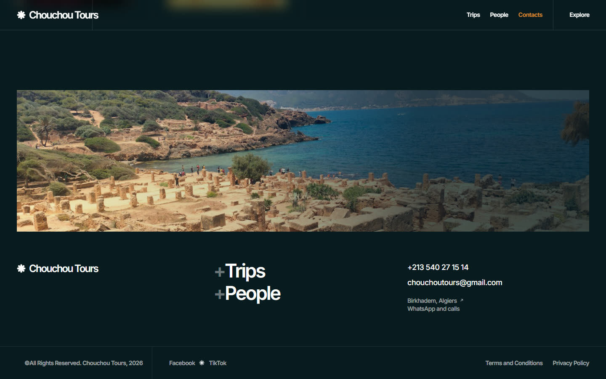
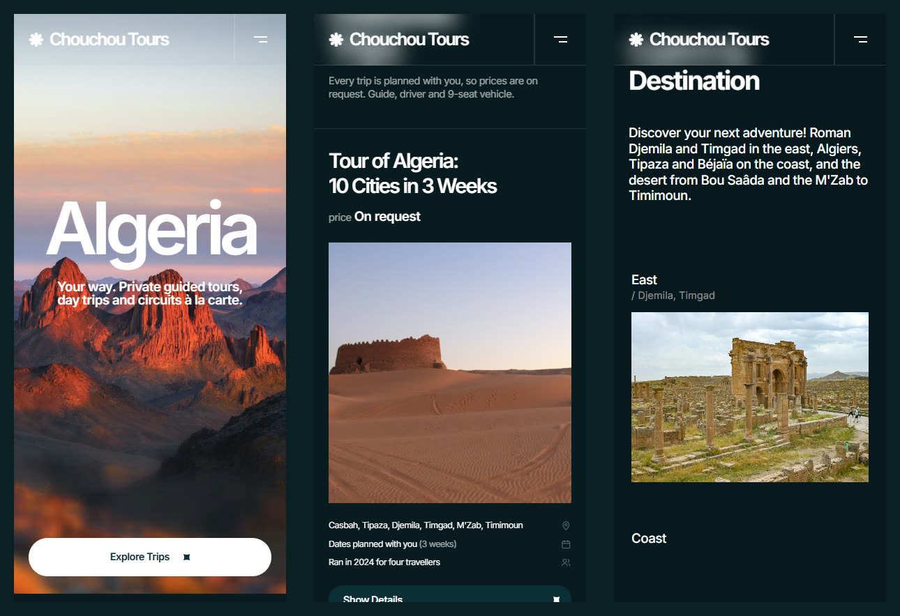

# Agence de voyage: Atlas homepage

Concept homepage for **Atlas**, a travel agency in Birkhadem, Algiers, that runs private guided visits, day trips and circuits à la carte across Algeria. The agency has no website, so this page was made as a proposal for them. It is not their official site and is not affiliated with them. The live page says so in its footer and asks search engines not to index it.

Stack: Vite, vanilla JS, GSAP with ScrollTrigger, d3-geo for the map. Font: Inter.



## Sections

### Hero
"Algeria" sits between the mountains and the foreground of a Hoggar sunset.

### One road trip
Atlas's three-week tour of Algeria in numbers, with desert, city and Roman-site cards.



### Featured trips
Six trips the agency has actually run. Prices aren't published, so every card says "On request". "Show Details" opens a panel with the route and what the trip includes.



### Explore by destination
A map of every place the agency has taken travellers, drawn in code with d3-geo. The city dots pop in and pulse.



### People of Algeria
The faces you meet on a trip, and the guesthouse stays and family meals of the agency's cultural and solidarity tourism.



### Footer
WhatsApp, email, the Birkhadem address on Google Maps, Facebook and TikTok.



### On phones



## Run

```
npm install
npm run dev      # http://localhost:5173
npm run build    # static site in dist/
```

Add `?clean` to the URL for the variant without step counters, small section labels and divider lines.

## What is in code

- Layout, type, icons, buttons, all motion (intro, line-by-line heading reveals, parallax).
- Hero depth effect: the photo is drawn twice and the front copy is masked along the ridge line, so the headline sits between the mountains and the foreground, with a blurred band at the bottom.
- The map of tour cities (d3-geo with world-atlas outline data).

## Content

Every fact comes from a public source, checked in November 2026:
- The agency's Facebook page (facebook.com/chouchoutours) and TikTok bio (tiktok.com/@chouchoutours): the offer, the 9-seat vehicle, the guesthouse and rental, follower counts.
- Its Google Maps listing: the Birkhadem address and the 4.4 rating from 137 reviews.
- visa-algerie.com reports on her trips (April 2025, November 2025, February 2026, August 2026): the trips and routes in `src/main.js` and `src/trips.js`.

Prices are not published, so every trip says "On request". Ratings and follower counts change; update them before showing the page.

To check with the agency before launch:
- Prices, trip lengths and what each trip includes.
- Whether they want English, French or both (their clients and posts are mostly French).
- Real photos of their trips and of the guide. The portraits in the "People of Algeria" section are stock photos captioned by place, not staff.
- If they take the site: remove the `noindex` tag in `index.html` and replace the concept notice in the footer.

## Photos

All photos are free-licensed (Unsplash and Pexels). Photographers and sources are listed in [CREDITS.md](CREDITS.md).
